# OpenStation user guide

This guide describes **version 0.1.0, Build 14** as implemented in the current source. The board uses a rotary encoder with a pushbutton. The factory cartridge data is provisional: select the correct family and calibrate the actual iron before relying on the displayed temperature. The [firmware datasheet](FIRMWARE_DATASHEET.md) summarizes the configured limits.

## Start and main screen

At startup, the heater output is held off. The screen may show a tip warning if **System → Boot Tip Warn** is enabled; click to close it. Connect the iron, select its family or saved custom profile, and check the displayed supply voltage before clicking to start heating. An open temperature input is treated as no tip and prevents heating.

The main screen shows **Actual** and **Set** temperatures, three preset temperatures, a state box, duty bar and percentage, active tip/profile name, supply voltage, current, and power. The portrait and landscape layouts contain the same core information. During boost, the state box is **yellow with black “Boost” text and a remaining `MM:SS` timer below it**. The Set number changes to the **effective boosted target in red**; beside **Set**, a red label such as `(+60°C)` shows the actual increase after station/tip limits. The current shown is an estimate averaged over the full heater cycle; power is the measured supply voltage multiplied by that estimated average current. It is not a separate wattmeter reading. The timer area shows a stand-delay or sleep countdown when relevant.

## Encoder controls

| Action | Main screen | Settings/menu |
| --- | --- | --- |
| Rotate | Change the base set temperature by the configured encoder step. Rotation while boosting ends boost and applies the new base setpoint. Changing the setpoint clears the preset highlight. | Move selection, or change the highlighted value while editing. |
| Single click | Start/stop heating; clicking while boosting turns the heater off. When a fault is latched, attempt to acknowledge it after the condition clears. A click first closes an open fault or boot-warning popup. | Open/select an item, toggle edit mode, or confirm an action. |
| Double click | While inactive, cycle through the three presets. While heating, start boost at the configured temperature increase and duration; each further double click **adds the configured Boost Timer to the remaining time**. Setting Boost Temp to **OFF** disables boost. | In the profile manager, open actions for a custom profile; in the name editor, backspace. |
| Long press | Turn the heater off and open settings. | Turn the heater off and return to the main screen; also exits calibration. |

The long-press threshold is **800 ms** and the double-click window is **300 ms**. Encoder and button actions request a short buzzer response when sound is enabled. The station also has a boot sound and event/fault sounds.

Boost time can accumulate up to **99:59** so the status box remains readable. Repeated double-clicks do not raise the boost temperature again; they only add time. The target returns to the base setpoint when the timer expires, when the encoder is rotated, or when heating is stopped.

## Settings

Long-press to open the seven groups: **General**, **Presets**, **Tips**, **Profiles**, **Display**, **Sound**, and **System**. Rotate to an item and click to enter or edit it. Changes made on screen are not all permanent until **System → Save to Flash** (or an action that explicitly saves a profile/selection) succeeds. **Discard Changes** reloads the saved configuration. **Factory Reset** restores compiled defaults, clears custom profiles, and saves the reset configuration.

- **General:** station maximum target (up to **500 °C**), **Boost Temp** (**0–100 °C** above setpoint in 5 °C steps; zero displays **OFF**), **Boost Timer** (**15–120 s** in 5 s steps), active tip's sleep setpoint, sleep delay (**0–30 s**; zero displays **INSTANT**), sleep time (**30–1800 s**), sleep type, encoder step, and encoder direction. Boost remains bounded by the station and active-tip temperature limits. Sleep time moves by 10 s normally and by 30 or 60 s when the knob turns faster.
- **Presets:** three editable setpoints, initially **300, 350, and 400 °C**. A preset above the active profile/station limit cannot be selected.
- **Tips:** manually select C115, C210, C245, C470, T12, TX1, TX2, GOOT, or APOLLO. The firmware does **not** automatically identify the cartridge by resistance. Changing profiles stops heat and requires a new click to resume.
- **Display:** backlight level and portrait/landscape orientation, each with a 180° option.
- **Sound:** buzzer and ready-beep options.
- **System:** boot tip warning, **Ignore Faults**, Save to Flash, Factory Reset, Discard Changes, About, and Exit.

**Ignore Faults is a debugging option.** It bypasses most software fault checks, but **ADC Stale** and **Pulse Time** still stop the heater. It does not make the factory profile values validated or the supply limits safe for an arbitrary tip. The compiled Build 14 configuration also permits uncharacterized factory profiles to heat; that is a development setting, not a characterization result.

When no valid saved settings exist, the compiled defaults are: C245 family, **5 °C** encoder steps, **+50 °C** boost for **30 s**, **5 s** stand delay, **1200 s (20 min)** sleep time, **Screen On** sleep type, **150 °C** C245 sleep temperature, **75%** backlight, portrait display, and boot tip warning/buzzer/ready beep enabled. A valid record in flash takes precedence over these defaults. Build 13 settings already use the current flash format; Build 12 settings migrate in memory with the boost defaults and need **Save to Flash** to store the current format.

## UI tree

```mermaid
flowchart TD
    Main[Main screen] --> Settings[Settings]
    Main --> PresetAction[Double click while idle: cycle presets]
    Main --> HeatAction[Click: start or stop heat]
    Main --> BoostAction[Double click while heating: start or extend boost]
    Settings --> General[GENERAL]
    General --> GeneralTemp[Max Temp / Boost Temp / Boost Timer]
    General --> GeneralSleep[Sleep Temp / Sleep Delay / Sleep Time / Sleep Type]
    General --> GeneralEncoder[Encoder Step / Encoder Dir]
    Settings --> Presets[PRESETS]
    Presets --> PresetValues[Preset 1 / 2 / 3]
    Settings --> Tips[TIPS]
    Tips --> Families[Select one of nine tip families]
    Settings --> Profiles[PROFILES]
    Profiles --> Current[Current Profile / default family]
    Profiles --> Create["Create New: family, name, default or edit"]
    Profiles --> Manage["Manage Profiles: family, custom profile"]
    Manage --> ProfileActions["Load; double click for Rename, Edit, Remove"]
    Profiles --> Details[View Details]
    Details --> Limits[Temperature, power, PID, TC scale]
    Details --> Calibration[6-Point Values / Cal Wizard]
    Settings --> Display[DISPLAY]
    Display --> DisplayItems[Backlight / Orientation]
    Settings --> Sound[SOUND]
    Sound --> SoundItems[Buzzer / Ready Beep]
    Settings --> System[SYSTEM]
    System --> SystemSafety[Boot Tip Warn / Ignore Faults]
    System --> SystemStorage[Save to Flash / Factory Reset / Discard Changes]
    System --> SystemAbout[About / Exit]
```

## Tip profiles and calibration

**Profiles → Current Profile** shows the selected profile. **Create New** asks for a tip family and opens a name editor with a generic name such as `C245 TIP`. Names can contain uppercase letters, digits, and spaces, up to **12 characters**. Rotate to choose a character, click to advance, double-click to backspace, and click in the last position to finish. Duplicate names are rejected. Then choose whether to use the family defaults or edit the new profile. Each family has up to **10 custom profiles**.

**Profiles → Manage Profiles** groups custom profiles by family. A single click loads a profile; double-click opens actions to rename, edit, or remove it. **View Details** exposes the selected profile's default and maximum temperatures, sleep temperature, thermocouple scale/offset, configured maximum power, PID values, integral limit, **6-Point Values**, and **Cal Wizard**. Custom-profile changes and active selection are stored in internal flash by the corresponding save actions. Check the screen for a save failure before relying on persistence.

The calibration wizard uses six nominal points: **100, 200, 300, 350, 400, and 450 °C**. It warns that the tip may overshoot and asks for confirmation. An external tip thermometer is required: at each stable point, rotate to enter the external reading and click to accept. The six values are stored with the selected profile and displayed in **6-Point Values**. The wizard requires a connected tip, valid sensor data, no active fault, the iron removed from the stand, and a maximum setting of at least **450 °C**. If the reading behaves unexpectedly, stop heating and inspect the handle, cartridge, and analog front end before continuing. The initial six-point table and other factory profile constants are placeholders; they are **not** prevalidated calibration.

## Sleep and wake

Sleep can be requested by the stand input **PC17** or the handle tilt input **PC3**. The stand activates when pulled low. Placing a heating iron in the stand starts the configured **Sleep Delay** countdown and sounds a beep; removing it during that countdown cancels the delay and sounds a beep. When the delay expires, the controller regulates toward the selected tip profile's sleep temperature. Set the delay to zero for immediate stand sleep.

The VIB input is externally pulled low on this board. A connected tilt sensor must first drive it high to arm detection; a subsequent low then requests sleep immediately. Thus an unconnected low PC3 does not by itself put the station to sleep. The station wakes when both sleep inputs clear and beeps on exit from sleep.

**Sleep Time** counts how long the tip remains at the sleep setpoint after sleep begins. At expiry, heating turns off. **Sleep Type** selects **No Sleep** (disable stand/VIB sleep), **Screen On** (leave display lit), **Screen Dim** (20% backlight after timeout), or **Screen Off** (display off after timeout). Lifting the iron after a timed-out sleep restores the display, but heating remains off until clicked on again. Separately, the controller turns heat off after **30 minutes** of inactivity outside sleep.

## Faults

A fault forces the heater off and presents a details popup with a snapshot. A click **closes the popup**; it does not itself clear the latched fault. Correct the cause, then click again to attempt acknowledgement. **Sensor Drop** requires a reset and inspection rather than a button acknowledgement. Tip Open, Sensor Low, Over Temp, VIN Range, Off Current, ADC Stale, and Pulse Time correspond to checks in the current code. Some fault names in the firmware are reserved enum values and are not active current-limit detectors; there is currently no instantaneous maximum-current trip. If a fault repeats, leave heating off and diagnose the board and cartridge.
