# OpenStation user guide

This guide describes **version 0.1.0, Build 16d** as implemented in the current source. The board uses a rotary encoder with a pushbutton. The factory cartridge data is provisional: select the correct family and calibrate the actual iron before relying on the displayed temperature. The [firmware datasheet](FIRMWARE_DATASHEET.md) summarizes the configured limits.

## Start and main screen

At startup, the heater output is held off. A blank or factory-reset settings page opens **Welcome → Setup wizard**. Click to continue. **Calibrate your tip** is selected initially and highlighted in green; choose a family in **Tip setup**. **Use factory defaults** requires two separate Yes confirmations, each initially set to No. Normal heating remains disabled until setup is successfully saved. A valid completed older settings record skips Welcome and may show the tip-match warning if **System → Boot Tip Warn** is enabled; click to close it. First-time Tip Setup does not leave a hidden boot warning behind its result screen. Select the matching family/profile and check supply voltage before clicking to heat.

The main screen shows **Actual** and **Set** temperatures, three preset temperatures, a state box, duty bar and percentage, active tip/profile name (factory profiles show a **Default** note), supply voltage, current, and power. The interface uses a **160 × 128 landscape** layout. During boost, the state box is **yellow with black “Boost” text and a remaining `MM:SS` timer below it**. The Set number changes to the **effective boosted target in red**; beside **Set**, a red label such as `(+60°C)` shows the actual increase after station/tip limits. The current shown is an estimate averaged over the full heater cycle; power is the measured supply voltage multiplied by that estimated average current. It is not a separate wattmeter reading. The timer area shows a stand-delay or sleep countdown when relevant.

The screen renders below follow the Build 16d drawing code. **Temperatures, ADC counts, voltage, current, power, timers, and profile counts are illustrative**; they were not captured from the connected board. Open an SVG to inspect the 160 × 128 pixels at full size.

### First-boot screens

| Welcome and route | Factory confirmations |
| --- | --- |
| **Welcome:** click to continue. 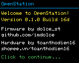 | **Choose a route:** calibration is selected in green; factory defaults remain white. 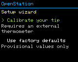 |
| **First factory confirmation:** No is selected by default. 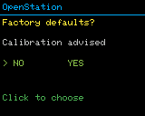 | **Second factory confirmation:** No is selected again. 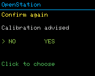 |

| Tip selection and room reference | Sensitivity choice |
| --- | --- |
| **Tip setup:** select the cartridge family that is physically installed. 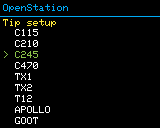 | **Room reference:** enter ambient temperature and capture a heater-off baseline. 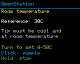 |
| **Known sensitivity:** turn to enter a value, or click without changing it to calibrate. 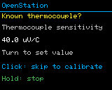 | **Known-value notice:** the entered value belongs to this profile and can be refined later. 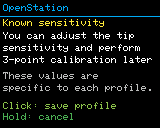 |

| Thermometer route | Completion and error |
| --- | --- |
| **Preheat check:** tip, supply, power/duty limits, and overshoot warning. 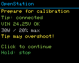 | **200 °C capture:** live ADC and estimate, external reading, and remaining time. 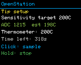 |
| **Result:** save the staged profile, retry, or cancel; only the selected item is green. 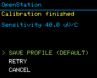 | **Stopped:** shows the current stop reason and a way back to setup. 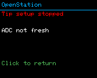 |

The optional boot tip-match warning asks you to compare the selected profile with the installed cartridge; click to close it. 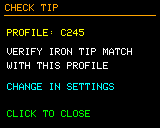

### Main-screen states

The same dashboard layout carries different state labels. **No tip** replaces the measured temperature with dashes; **Idle** is ready for a click. **Active** shows heating and the duty bar; **Boost** also shows its timer and boosted Set value.

| No tip and idle | Active and boost |
| --- | --- |
| 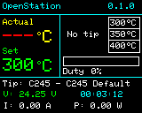 | 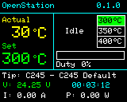 |
| 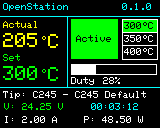 | 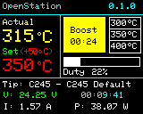 |

**Stand** shows the delay before sleep. **Sleep** shows the remaining sleep time; **Cool** indicates heating is off while the tip cools. A fault first opens its details popup; after closing it, the red **Fault** state remains until the fault is cleared.

| Stand delay and sleep | Cooling and fault |
| --- | --- |
| 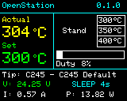 | 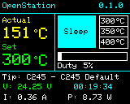 |
| 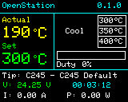 | 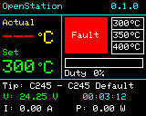 |

## Encoder controls

| Action | Main screen | Settings/menu |
| --- | --- | --- |
| Rotate | Change the base set temperature by the configured encoder step. Rotation while boosting ends boost and applies the new base setpoint. Changing the setpoint clears the preset highlight. | Move selection, or change the highlighted value while editing. |
| Single click | Start/stop heating; clicking while boosting turns the heater off. When a fault is latched, attempt to acknowledge it after the condition clears. A click first closes an open fault or boot-warning popup. | Open/select an item, toggle edit mode, or confirm an action. |
| Double click | While inactive, cycle through the three presets. While heating, start boost at the configured temperature increase and duration; each further double click **adds the configured Boost Timer to the remaining time**. Setting Boost Temp to **OFF** disables boost. | In the profile manager, open actions for a custom profile; in the name editor, backspace. |
| Long press | Turn the heater off and open settings. | Turn the heater off and return to the main screen; also exits calibration. |

The long-press threshold is **800 ms** and the normal double-click window is **300 ms**. During Tip Setup, a click is delivered promptly on release: it starts the next step or requests a temperature sample, while an 800 ms hold stops setup and cuts heat. Encoder and button actions request a short buzzer response when sound is enabled. The station also has a boot sound and event/fault sounds.

Boost time can accumulate up to **99:59** so the status box remains readable. Repeated double-clicks do not raise the boost temperature again; they only add time. The target returns to the base setpoint when the timer expires, when the encoder is rotated, or when heating is stopped.

## Settings

Long-press to open the seven groups: **General**, **Presets**, **Tips**, **Profiles**, **Display**, **Sound**, and **System**. Rotate to an item and click to enter or edit it. Changes made on screen are not all permanent until **System → Save to Flash** (or an action that explicitly saves a profile/selection) succeeds. **Discard Changes** reloads the saved configuration. **Factory Reset** restores compiled defaults, clears custom profiles, and saves the reset configuration.

- **General:** station maximum target (up to **500 °C**), **Boost Temp** (**0–100 °C** above setpoint in 5 °C steps; zero displays **OFF**), **Boost Timer** (**15–120 s** in 5 s steps), active tip's sleep setpoint, sleep delay (**0–30 s**; zero displays **INSTANT**), sleep time (**30–1800 s**), sleep type, encoder step, and encoder direction. Boost remains bounded by the station and active-tip temperature limits. Sleep time moves by 10 s normally and by 30 or 60 s when the knob turns faster.
- **Presets:** three editable setpoints, initially **300, 350, and 400 °C**. A preset above the active profile/station limit cannot be selected.
- **Tips:** manually select C115, C210, C245, C470, T12, TX1, TX2, GOOT, or APOLLO. The firmware does **not** automatically identify the cartridge by resistance. Changing profiles stops heat and requires a new click to resume.
- **Display:** backlight level and either normal or **180° flipped landscape** orientation. Saved portrait selections migrate to normal landscape.
- **Sound:** buzzer and ready-beep options.
- **System:** boot tip warning, **Ignore Faults**, Save to Flash, Factory Reset, Discard Changes, About, and Exit.

The settings index opens the seven groups. The screenshots show the first visible page of each scrollable list; rotating the encoder reveals any remaining items. The highlighted row is the current selection, while editing uses a different highlight color.

| Settings index | General |
| --- | --- |
| 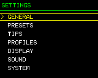 | 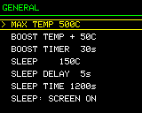 |

| Presets | Tips |
| --- | --- |
| 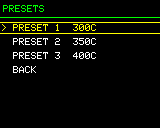 | 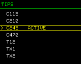 |

| Display | Sound |
| --- | --- |
| 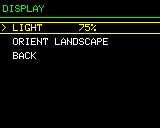 | 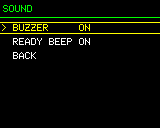 |

| System | About |
| --- | --- |
| 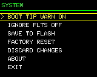 | 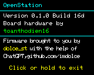 |

**Ignore Faults is a debugging option.** It bypasses most software fault checks, but **ADC Stale** and **Pulse Time** still stop the heater. It does not make the factory profile values validated or the supply limits safe for an arbitrary tip. The compiled Build 16d configuration also permits uncharacterized factory profiles to heat; that is a development setting, not a characterization result.

When no valid saved settings exist, the compiled defaults are: C245 family, **30 °C** shared manual room reference, **5 °C** encoder steps, **+50 °C** boost for **30 s**, **5 s** stand delay, **1200 s (20 min)** sleep time, **Screen On** sleep type, **150 °C** C245 sleep temperature, **75%** backlight, landscape display, and boot tip warning/buzzer/ready beep enabled. A valid record in flash takes precedence over these defaults. Saved Build 14 and version-11 settings and custom profiles take precedence over factory values. A version-11 record marked incomplete still opens Welcome. Factory Reset clears custom profiles and returns to Welcome.

## UI tree

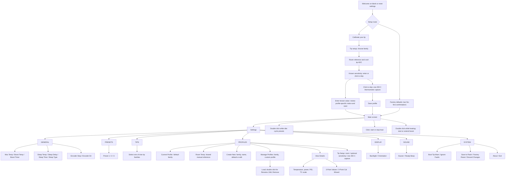

## Tip profiles and calibration

**Profiles → Current Profile** shows the selected profile; a factory profile appears as, for example, `C245 default`. **Create New** asks for a tip family and opens a name editor with a generic name such as `C245 TIP`. Names can contain uppercase letters, digits, and spaces, up to **12 characters**. Rotate to choose a character, click to advance, double-click to backspace, and click in the last position to finish. Duplicate names are rejected. Then choose whether to use the family defaults or edit the new profile. Each family has up to **10 custom profiles**.

**Profile creation screens:** the root box identifies the loaded profile; the family list shows custom slots used out of ten. The name editor's underline is the current character position, and the final page chooses default values or immediate editing.

| Current profile | Choose family |
| --- | --- |
| 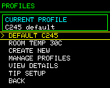 | 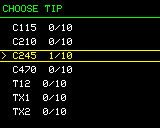 |
| 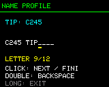 | 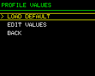 |

**Profiles → Room Temp** is a shared manual reference adjustable from **0–50 °C**. Tip Setup copies its room entry here only when the profile is successfully saved. Later edits require **System → Save to Flash** to persist. Editing stops heating and shifts the estimated temperature relative to the profile's calibration room. The board has no room-temperature sensor.

**Profiles → Manage Profiles** groups custom profiles by family. A single click loads a profile; double-click opens actions to rename, edit, or remove it. **View Details** exposes the selected profile's default and maximum temperatures, sleep temperature, thermocouple sensitivity, configured maximum power, PID values, integral limit, **3-Point Values**, and **Cal Wizard**. **Tip Setup** is an entry in the Profiles root. Custom-profile changes and active selection are stored in internal flash by the corresponding save actions. Check the screen for a save failure before relying on persistence.

**Profile management screens:** choose a family, open a custom profile, then use its action list. Remove is a separate confirmation. The details list scrolls to the remaining parameters and calibration entries; 3-Point Values shows the stored 200, 300, and 400 °C entries for that profile.

| Family folders | Profiles in a family |
| --- | --- |
| 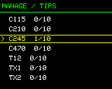 | 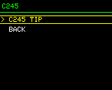 |
| 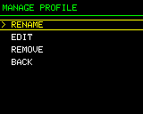 | 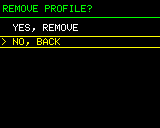 |
| 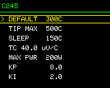 | 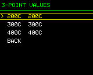 |

**Profiles → Tip Setup** starts with the shared room reference (**0–50 °C**, factory default **30 °C**). For a profile without a saved room reference, the tip must actually be cool and at room temperature when the heater-off ADC baseline is captured; a calibrated profile can reuse its reconstructed room reference. On **Known thermocouple?**, the screen labels the value **Thermocouple sensitivity** and says **Turn to set value**. Rotate to enter a value in **0.1 µV/°C** steps, then click. A profile-specific reminder appears: sensitivity can be adjusted and the three-point calibration can be done later. Click that screen to save without heating, or hold to cancel. The entered sensitivity and internal calibration intercept apply only to the selected profile, while the room entry updates the shared manual reference on a successful save. Its prior correction values reset to neutral anchors, and it remains marked uncharacterized because no thermometer check occurred. The current development build still permits uncharacterized profiles to heat. If you click the sensitivity screen without rotating, the known-value route is skipped and the single 200 °C sensitivity check begins. That check uses an external thermometer, a **30 W estimated / 20% duty** cap, and a **600-second** timeout; enter the actual reading and click for a fresh heater-off ADC capture. Hold for **800 ms** to stop and cut heat. Review **Save Profile (Default)**, **Retry**, or **Cancel**; only the selected option is green. Saving the checked value marks the selected profile characterized and resets its correction values to neutral anchors. Failed or cancelled setup leaves the previous profile unchanged.

**Invalid sensitivity** means the captured ADC voltage did not rise above the room baseline as the thermometer temperature rose, the calculated pre-amplifier sensitivity was outside **8–95 µV/°C**, or the derived room offset was outside **−100 to +100 °C**. A single reading only calibrates a linear slope; it does not prove accuracy across the full operating range. The wizard does not stop solely because conversions within one ADC burst vary, but connected-tip, ADC freshness, supply, and heater checks remain active.

Sensitivity in **View Details** is the nominal *pre-amplifier* value in **0.1 µV/°C** steps. The firmware retains the ADC-side slope internally; simply viewing a saved value does not rewrite it. The provisional defaults are C115/C210 **9.5**, C245/C470 **40**, T12/TX1/TX2 **21**, and GOOT/APOLLO **41 µV/°C**, using a nominal **126×** amplifier gain. These are starting estimates, not verified cartridge specifications. Changing sensitivity without repeating calibration can make the stored correction curve inaccurate.

Factory maximum-power settings are **150 W** for C210, TX1, TX2, T12, and GOOT; **200 W** for C245 and APOLLO; and **400 W** for C470. C115 retains its previous **400 W** configured value. The editable and enforced power ceiling is **800 W** for every profile. These are firmware limits, not verified cartridge or board ratings; saved profile limits take precedence over revised factory defaults.

The separate **Cal Wizard** now measures **three points: 200, 300, and 400 °C**. It warns about overshoot and requires an external thermometer. At each stable point, rotate to enter the external reading and click to accept. The station and profile maximum must allow the profile's mapped 400 °C calibration target, which can be above 400 °C when an older correction curve is active. Saving stores the three readings for the selected profile and derives the remaining 100/350/450 °C correction anchors by endpoint correction and interpolation, retaining the existing six-anchor flash format. **3-Point Values** displays and edits only the 200, 300, and 400 °C readings. Editing one re-derives the hidden 100, 350, and 450 °C values; the six-anchor flash format remains for compatibility. The wizard still requires a connected tip, valid sensor data, no fault, and an iron removed from the stand. The factory correction values remain provisional placeholders.

The **Cal Wizard** warning is separate from first-boot Tip Setup's 30 W / 20% preheat check. During its active screen, **BASE TEMP** is the temperature before the stored correction curve, **EXTERNAL** is the thermometer entry, **STATION** is the corrected reading, and **SPAN** reports variation in the ADC burst. The point counter advances from 1/3 to 3/3.

| Calibration warning | Active point |
| --- | --- |
| 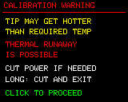 | 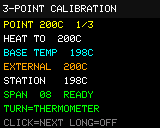 |

## Sleep and wake

Sleep can be requested by the stand input **PC17** or the handle tilt input **PC3**. The stand activates when pulled low. Placing a heating iron in the stand starts the configured **Sleep Delay** countdown and sounds a beep; removing it during that countdown cancels the delay and sounds a beep. When the delay expires, the controller regulates toward the selected tip profile's sleep temperature. Set the delay to zero for immediate stand sleep.

The VIB input is externally pulled low on this board. A connected tilt sensor must first drive it high to arm detection; a subsequent low then requests sleep immediately. Thus an unconnected low PC3 does not by itself put the station to sleep. The station wakes when both sleep inputs clear and beeps on exit from sleep.

**Sleep Time** counts how long the tip remains at the sleep setpoint after sleep begins. At expiry, heating turns off. **Sleep Type** selects **No Sleep** (disable stand/VIB sleep), **Screen On** (leave display lit), **Screen Dim** (20% backlight after timeout), or **Screen Off** (display off after timeout). Lifting the iron after a timed-out sleep restores the display, but heating remains off until clicked on again. Separately, the controller turns heat off after **30 minutes** of inactivity outside sleep.

## Faults

A fault forces the heater off and presents a details popup with a snapshot. A click **closes the popup**; it does not itself clear the latched fault. Correct the cause, then click again to attempt acknowledgement. **Sensor Drop** requires a reset and inspection rather than a button acknowledgement. Tip Open, Sensor Low, Over Temp, VIN Range, Off Current, ADC Stale, and Pulse Time correspond to checks in the current code. Some fault names in the firmware are reserved enum values and are not active current-limit detectors; there is currently no instantaneous maximum-current trip. If a fault repeats, leave heating off and diagnose the board and cartridge.

The fault popup names the problem and shows a snapshot of supply voltage, temperature, PA1 temperature ADC, and PA6 current ADC. The example below uses **ADC Stale**; other faults share this layout, and VIN Range adds the selected family's configured supply range.

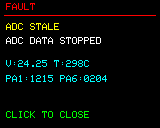
